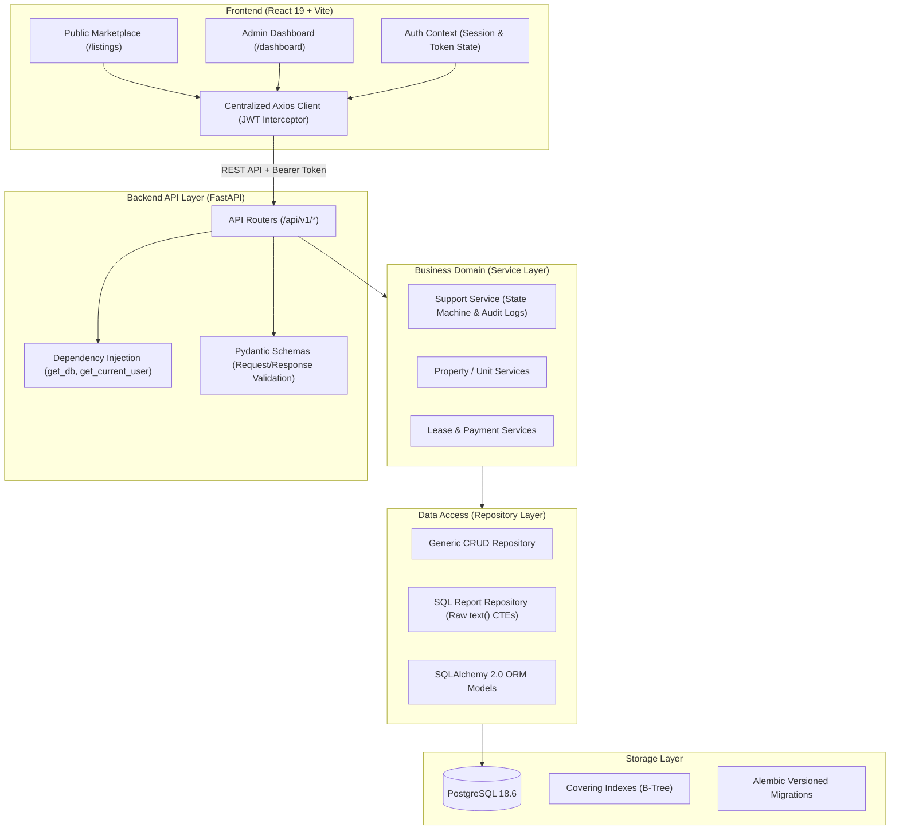
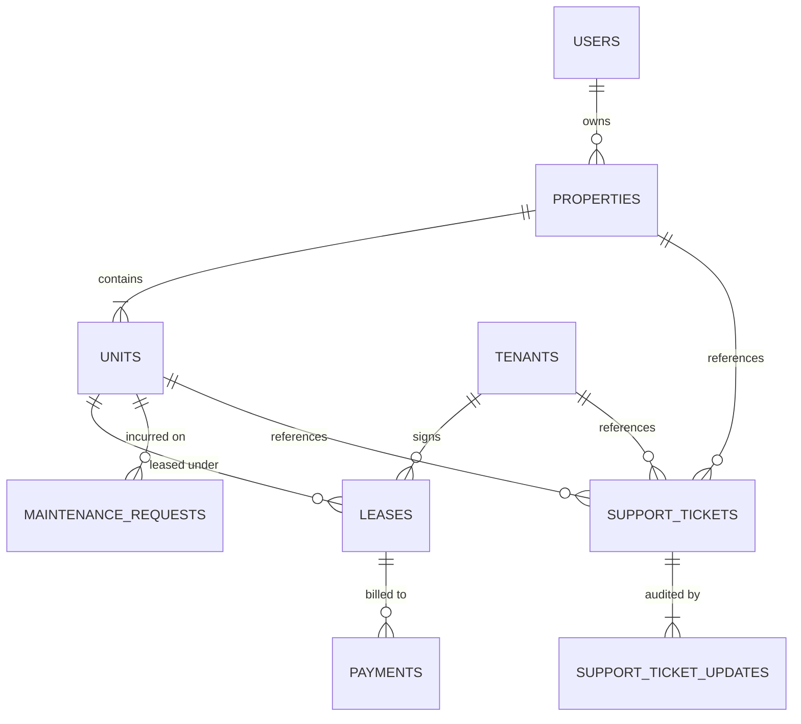

# PropQuery — System Architecture & Technical Deep Dive

> **Comprehensive architectural overview, relational database design, query optimization, and interview guide for PropQuery.**

---

## 1. Executive Summary & Elevator Pitch

**PropQuery** is an enterprise-style property management reporting and application support system built following **Clean Architecture** principles. It streamlines operations across property portfolios—managing properties, units, tenant leases, payments, maintenance requests, and support escalations.

The system is engineered to showcase:
1. **Advanced SQL Business Intelligence:** Direct in-database execution of complex operational reports (Real-time Occupancy percentages, Month-to-Date Rent Collection with CTEs, Maintenance turnaround metrics) using PostgreSQL native query planning.
2. **Database Performance Optimization:** Elimination of sequential table scans through covering indexes designed via `EXPLAIN ANALYZE`.
3. **Application Support State Machine:** Strict lifecycle enforcement for operational issues with immutable audit trail logging.
4. **Clean Architecture:** Strict decoupling between API routing, business domain services, and repository data access.
5. **Deterministic Testing:** Rapid integration test execution using in-memory SQLite isolation with dependency overrides.

---

## 2. High-Level System Architecture

PropQuery separates presentation, business logic, and persistence into clear architectural boundaries:



### Architectural Layer Responsibilities

```text
app/
 ├── api/routes/      # FastAPI endpoint definitions (HTTP params, status codes, auth guard)
 ├── services/        # Business logic & state transitions (e.g. audit logs, business validation)
 ├── repositories/    # SQLAlchemy data access & native SQL queries
 ├── schemas/         # Pydantic validation models (In/Out DTOs)
 ├── models/          # SQLAlchemy table schemas & declarative base
 └── core/            # Config (pydantic-settings), Security (JWT), and DB engine session
```

*Data Flow Principle: Route $\longrightarrow$ Service $\longrightarrow$ Repository $\longrightarrow$ Database*

- **API Layer (`app/api/routes`)**: No direct database access or business logic. Receives requests, triggers Pydantic schema validation, and delegates to services.
- **Service Layer (`app/services`)**: Orchestrates operations across multiple repositories and enforces transactional business rules (e.g., creating an audit log update when a ticket status changes).
- **Repository Layer (`app/repositories`)**: Encapsulates ORM queries and raw SQL execution via SQLAlchemy `text()`.
- **Database Engine (`app/core/database.py`)**: Manages the connection pool, session lifecycle with FastAPI `Depends(get_db)`.

---

## 3. Relational Database Design & Constraints

The relational schema is normalized to 3NF and enforces integrity at the database engine level via `CHECK` constraints, foreign keys, and indexes:



| Table | Primary Responsibilities | Key Integrity Constraints & Indexes |
| :--- | :--- | :--- |
| **`users`** | Authentication and authorization | `UNIQUE(email)`, indexed `email`, hashed passwords, role default `'tenant'`. |
| **`properties`** | High-level property assets | Indexed `owner_id`, address fields. |
| **`units`** | Rentable units within a property | FK $\to$ `properties(id)`, `CHECK(status IN ('occupied', 'vacant'))`, `CHECK(market_rent > 0)`. |
| **`tenants`** | Resident contact and identity | `UNIQUE(email)`, index on `last_name`. |
| **`leases`** | Rental contractual agreements | FK $\to$ `units(id)`, FK $\to$ `tenants(id)`, `CHECK(end_date > start_date)`, `CHECK(monthly_rent > 0)`, `status IN ('active', 'expired', 'terminated')`. |
| **`payments`** | Rent transactions | FK $\to$ `leases(id)`, `CHECK(amount > 0)`, `CHECK(status IN ('completed', 'pending', 'failed'))`, indexed on `payment_date`. |
| **`maintenance_requests`** | Property upkeep tickets | FK $\to$ `units(id)`, `priority IN ('low', 'medium', 'high', 'urgent')`, `status IN ('open', 'in_progress', 'resolved', 'closed')`. |
| **`support_tickets`** | Application & operational issues | Nullable FKs to `properties`, `units`, `tenants`. Status: `open` $\to$ `investigating` $\to$ `resolved`. |
| **`support_ticket_updates`** | Immutable audit log trail | FK $\to$ `support_tickets(id)`, stores `old_status`, `new_status`, `update_type`, `author`, and timestamp. |

---

## 4. Key Engineering Implementations

### 4.1 In-Database SQL Reporting Engine
Rather than loading thousands of ORM objects into Python memory, business analytics are executed natively in PostgreSQL via `ReportRepository` (`app/repositories/reports.py`):

#### Rent Collection Report (Common Table Expressions - CTE)
Aggregates expected active lease revenue against actual completed collections within the current calendar month:

```sql
WITH ExpectedRent AS (
    SELECT 
        p.id AS property_id,
        p.name AS property_name,
        SUM(l.monthly_rent) AS expected_rent
    FROM properties p
    JOIN units u ON p.id = u.property_id
    JOIN leases l ON u.id = l.unit_id
    WHERE l.status = 'active'
    GROUP BY p.id, p.name
),
CollectedRent AS (
    SELECT 
        p.id AS property_id,
        SUM(pay.amount) AS collected_rent
    FROM properties p
    JOIN units u ON p.id = u.property_id
    JOIN leases l ON u.id = l.unit_id
    JOIN payments pay ON l.id = pay.lease_id
    WHERE pay.status = 'completed'
      AND EXTRACT(MONTH FROM pay.payment_date) = EXTRACT(MONTH FROM CURRENT_DATE)
      AND EXTRACT(YEAR FROM pay.payment_date) = EXTRACT(YEAR FROM CURRENT_DATE)
    GROUP BY p.id
)
SELECT 
    er.property_name,
    COALESCE(er.expected_rent, 0) AS expected_rent,
    COALESCE(cr.collected_rent, 0) AS collected_rent,
    GREATEST(0, COALESCE(er.expected_rent, 0) - COALESCE(cr.collected_rent, 0)) AS outstanding_amount,
    CASE 
        WHEN COALESCE(er.expected_rent, 0) = 0 THEN 0.0
        ELSE ROUND((COALESCE(cr.collected_rent, 0) / er.expected_rent) * 100, 2)
    END AS collection_percentage
FROM ExpectedRent er
LEFT JOIN CollectedRent cr ON er.property_id = cr.property_id
ORDER BY er.property_name;
```

#### Real-time Occupancy Percentage
Calculates occupancy metrics without multiple roundtrips:
```sql
SELECT 
    p.name AS property_name,
    COUNT(u.id) AS total_units,
    SUM(CASE WHEN u.status = 'occupied' THEN 1 ELSE 0 END) AS occupied_units,
    SUM(CASE WHEN u.status = 'vacant' THEN 1 ELSE 0 END) AS vacant_units,
    CASE 
        WHEN COUNT(u.id) = 0 THEN 0.0
        ELSE ROUND((SUM(CASE WHEN u.status = 'occupied' THEN 1.0 ELSE 0.0 END) / COUNT(u.id)) * 100, 2)
    END AS occupancy_percentage
FROM properties p
LEFT JOIN units u ON p.id = u.property_id
GROUP BY p.id, p.name
ORDER BY p.name;
```

---

### 4.2 Query Performance Optimization & Covering Indexes

As detailed in `docs/performance.md`, performance bottlenecks on reporting queries were analyzed using `EXPLAIN ANALYZE`.

#### Bottleneck
The Monthly Revenue report aggregates completed payments by month:
```sql
SELECT TO_CHAR(payment_date, 'YYYY-MM') AS revenue_month, SUM(amount), COUNT(id)
FROM payments
WHERE status = 'completed'
GROUP BY TO_CHAR(payment_date, 'YYYY-MM')
ORDER BY revenue_month DESC;
```
Even with a single-column index on `status`, PostgreSQL defaults to a **Sequential Scan (`Seq Scan`)** because ~98% of payments are `completed`. The query planner avoids the index because index scan + heap lookup costs more I/O than a sequential table scan.

#### Optimization: Covering Index
We designed a composite covering index:
```sql
CREATE INDEX ix_payments_covering ON payments(status, payment_date, amount);
```
With this index:
1. The filter condition `status = 'completed'` narrows the B-tree range.
2. The grouping and sorting key `payment_date` is read directly from the index.
3. The aggregate value `amount` is stored in the index tuple.
4. **Result:** PostgreSQL performs an **Index-Only Scan**, satisfying the query with zero disk heap reads.

---

### 4.3 Support State Transitions & Immutable Audit Logging

In `app/services/support_service.py`, tickets follow an enforced lifecycle (`open` $\to$ `investigating` $\to$ `resolved`):
- Ticket updates are executed within a database transaction.
- Any change in status or resolution notes automatically creates a linked `SupportTicketUpdate` record capturing:
  - `old_status` & `new_status`
  - `author` & `timestamp`
  - `content` explanation
- This guarantees complete traceability for operations and technical troubleshooting.

---

### 4.4 Real-World ETL Pipeline (`ingest_csv.py`)

A custom ETL script transforms a real-world Indian real estate dataset (`Real Estate Data V21.csv`) into PropQuery's schema:
- **Price Normalization:** Regex converts text pricing (`₹ 1.25 Cr`, `₹ 75 L`) to raw numerical INR.
- **Specification Extraction:** Parses unit types (BHK, apartments, independent floors) from listing titles.
- **Rental Yield Modeling:** Calculates realistic monthly rents using an annual yield factor (~4%).
- **Synthetic Data Generation:** Generates deterministic Indian tenant profiles, active leases, payments, and maintenance histories for testing.

---

### 4.5 Testing Strategy (Pytest & In-Memory SQLite)

The automated test suite in `tests/` features:
- **Zero Database Pollution:** Tests execute against an isolated in-memory SQLite database (`sqlite:///:memory:`).
- **FastAPI Dependency Overrides:**
  ```python
  app.dependency_overrides[get_db] = override_get_db
  app.dependency_overrides[get_current_user] = override_get_current_user
  ```
  Injects a pre-authenticated test admin into `TestClient(app)`, allowing integration tests to run with sub-second execution speeds.

---

## 5. Frontend Architecture & Design System

The frontend is built with **React 19**, **Vite**, and **Tailwind CSS v4**:

- **Centralized API Client (`src/api/client.js`):** Axios instance configured with request interceptors to attach `Authorization: Bearer <token>` and response interceptors to handle `401 Unauthorized` redirects.
- **Reusable Data Density (`DataTable.jsx`):** Generic data table supporting column definitions, custom cell rendering (badges, currency, action buttons), client-side pagination, empty and loading states.
- **Enterprise Design Aesthetic:** Restrained beige/taupe/charcoal visual palette optimized for scannability and high data density.
- **Dual Routing Layout:**
  - Public Marketplace: Guest browsing of available listings (`/` and `/listings/:id`).
  - Protected Admin Portal: Role-guarded dashboard for property admins (`/dashboard/*`).

---

## 6. Interview Preparation & Architectural Q&A

### Q1: Walk me through the architecture of PropQuery.
> *"PropQuery follows Clean Architecture with strict layer separation: API routes handle HTTP input validation via Pydantic; service layers orchestrate business logic and state transitions; repository layers handle database operations using SQLAlchemy and native SQL. On the frontend, React 19 communicates via an authenticated Axios client to the FastAPI backend, backed by PostgreSQL."*

### Q2: Why did you choose raw SQL for reporting instead of the ORM?
> *"While ORMs are ideal for transactional CRUD operations, complex analytical queries—like calculating month-to-date rent collections with multiple CTEs or occupancy ratios across properties—produce inefficient SQL or require pulling entire tables into application memory. Writing native SQL queries via SQLAlchemy `text()` lets the PostgreSQL query planner execute aggregations directly in-engine, maximizing throughput and minimizing memory overhead."*

### Q3: How did you approach query optimization?
> *"Using `EXPLAIN ANALYZE`, we found that high-cardinality reporting queries (like monthly revenue aggregates) triggered sequential table scans because the status filter had low selectivity. We resolved this by creating a covering index on `(status, payment_date, amount)`. This allows PostgreSQL to execute an Index-Only Scan, retrieving all necessary filter, grouping, and aggregation data straight from the B-tree without touching the table heap."*

### Q4: How do you handle testing without affecting production/local data?
> *"We use pytest fixtures with an in-memory SQLite database (`sqlite:///:memory:`). Through FastAPI's `dependency_overrides`, we swap the PostgreSQL session dependency with the SQLite test session and mock the authentication guard. This makes our test suite completely deterministic, fast, and safe to execute in CI/CD without needing a live database service."*

### Q5: How would you scale this architecture to handle 10M+ rows?
> *"I would adopt three scaling strategies:*
> 1. *Partitioning:* Partition the `payments` and `maintenance_requests` tables by date ranges (e.g. annual or monthly partitions).
> 2. *Materialized Views & Read Replicas:* Pre-aggregate historical reports into PostgreSQL Materialized Views refreshed on a schedule, and route read queries to read replicas.
> 3. *Caching:* Implement Redis caching for frequently accessed, slow-changing metrics like overall occupancy and property summaries."*
